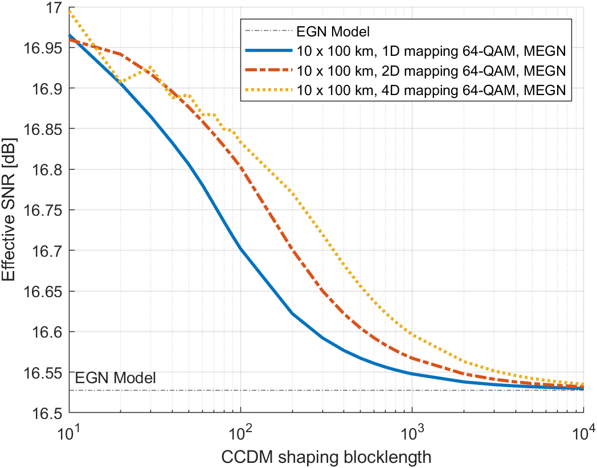

# MEGN MATLAB Demo

This repository provides a minimal MATLAB implementation of the finite-memory EGN (MEGN) model for fiber-optic channels.

The main entry point is:

```matlab
MEGN_Demo
```

The demo compares the standard EGN estimate with the MEGN correction for different CCDM shaping blocklengths and mapping strategies. It reproduces the calculations behind Fig. 9(b) of the accompanying arXiv paper and produces two figures:

- nonlinear coefficient eta versus CCDM shaping blocklength;
- optimum effective SNR versus CCDM shaping blocklength.

## Example Output

The effective SNR figure generated by `MEGN_Demo.m`:



## Repository Contents

- `MEGN_Demo.m` - minimal working example and reader-facing script.
- `MEGNModel.m` - reusable MEGN model class with kernel loading, kernel computation, and SCI correction.
- `calculateEGNSCI.m` - isolated baseline EGN calculation.
- `calculateSymbolCorrelations.m` - analytical CCDM symbol-correlation calculation.
- `etaToSNR.m` - eta-to-optimum-SNR conversion.
- `kernel_cache/` - precomputed kernel file for the demo configuration.

## Requirements

- MATLAB R2022a or newer is recommended.
- No external MATLAB toolboxes are required for the current demo.

## Quick Start

1. Open MATLAB.
2. Set the current folder to this repository.
3. Run:

```matlab
MEGN_Demo
```

The first run should load the 10-span demo kernel from `kernel_cache/`. If kernels are missing for a changed parameter set, `MEGNModel` computes them and stores them for future runs.

## Notes on Kernel Caching

Kernel computation is the main runtime bottleneck. The repository includes only the kernel file required by the minimum working example, where `sys.Ns = 10` and `model.tau_max = 50`. Cached kernels are organized by physical link and model-memory parameters.

If you change parameters such as symbol rate, span count, or memory length, the model may create a new cache entry. Longer-distance links generally require a larger memory length (`model.tau_max`) to capture more delayed symbol correlations, which also increases kernel-computation time and cache size.

## Paper Formula Synchronization (2026-11-19)

This update aligns the code with the paper: physical single-polarization kernels, summed over both polarizations and normalized by the cube of the total launch power.

- `P_chn` denotes per-polarization launch power; for the equal-power polarizations in this demo, `P_tot = 2*P_chn`.
- Kernel prefactors are four times their previous values. The MEGN PSD correction explicitly includes the factor of two for both polarizations, and eta is obtained by integrating the PSD and dividing by `P_tot^3`.
- The EGN/GN baseline uses the same convention, including the explicit `2*P_chn^3` PSD factor in both branches.
- The previous `kn_phi_1` kernel is renamed `kn_phi_4`, including its saved cache field, to match the paper notation. The baseline kernels are expressed as `phi1` through `phi4`.
- `calculateEGNSCI` now takes `P_chn` as its first argument; `eta_SCI_MEGN_Cal` now expects total power `P_tot`.
- The bundled 10-span kernel cache has been recomputed with these coefficients and names.

The normalization changes cancel: the kernel factor of four and polarization factor of two are balanced by `(2*P_chn)^3 = 8*P_chn^3`. The final EGN and MEGN eta curves are unchanged for the same parameters.


## Citation

The current GitHub release is [v1.0.1](https://github.com/billykaiquanwu-hub/MEGN-Model-for-Fiber-Nonlinear-Power-Estimate/releases/tag/v1.0.1), which synchronizes the code with the paper formulas. The citation below identifies the original archived v1.0.0 release; use the version-specific DOI of the release used in your work once its Zenodo archive is available.

Kaiquan Wu, Gabriele Liga, Marco Secondini, Stella Civelli, Hussam Batshon, Greg Raybon, Xi Chen, and Alex Alvarado, "MEGN MATLAB Demo," version 1.0.0, Zenodo, 2026. https://doi.org/10.5281/zenodo.20710628

```bibtex
@software{wu2026megn_matlab_demo,
  title = {MEGN MATLAB Demo},
  author = {Wu, Kaiquan and Liga, Gabriele and Secondini, Marco and Civelli, Stella and Batshon, Hussam and Raybon, Greg and Chen, Xi and Alvarado, Alex},
  year = {2026},
  version = {1.0.0},
  publisher = {Zenodo},
  doi = {10.5281/zenodo.20710628},
  url = {https://doi.org/10.5281/zenodo.20710628}
}
```

Please also cite the accompanying paper:

Kaiquan Wu, Gabriele Liga, Marco Secondini, Stella Civelli, Hussam Batshon, Greg Raybon, Xi Chen, and Alex Alvarado, "The Memory-Enhanced Gaussian Noise (MEGN) Model for Fiber-Optic Channels," arXiv:2604.11601, 2026. https://arxiv.org/abs/2604.11601

```bibtex
@misc{wu2026megn,
  title = {The Memory-Enhanced Gaussian Noise (MEGN) Model for Fiber-Optic Channels},
  author = {Wu, Kaiquan and Liga, Gabriele and Secondini, Marco and Civelli, Stella and Batshon, Hussam and Raybon, Greg and Chen, Xi and Alvarado, Alex},
  year = {2026},
  eprint = {2604.11601},
  archivePrefix = {arXiv},
  primaryClass = {eess.SP},
  doi = {10.48550/arXiv.2604.11601},
  url = {https://arxiv.org/abs/2604.11601}
}
```
